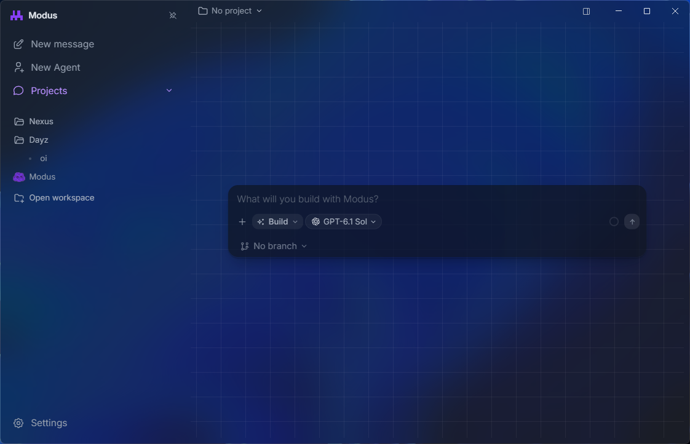

<p align="center">
  <a href="./README.md">English</a> · 简体中文
</p>

<p align="center">
  
</p>

<h1 align="center">Modus</h1>

<p align="center">
  简洁的 AI 辅助开发桌面工作区。<br>
  你的项目、你的模型，在同一个窗口中完成工作。
</p>

<p align="center">
  <a href="https://github.com/Stoltembergg/modus/releases/latest"></a>
  <a href="./LICENSE"></a>
</p>

<p align="center">
  <a href="#下载">下载</a> ·
  <a href="#主要功能">功能</a> ·
  <a href="#从源码构建">从源码构建</a> ·
  <a href="./CONTRIBUTING.md">参与贡献</a>
</p>



打开项目，选择模型，描述想要实现的结果。Modus 将对话、Agent 工具、代码、终端、浏览器和 Git 集成到同一个桌面工作区，需要时即可查看活动详情。

## 下载

**[获取最新稳定版 →](https://github.com/Stoltembergg/modus/releases/latest)**

在发行版附件中选择适合系统的安装包：

| 平台 | 架构 | 安装包 |
| --- | --- | --- |
| Windows | x64 | `.exe` 安装程序 |
| macOS | Apple Silicon 或 Intel | 对应架构的 `.dmg` |
| Linux | x64 | `.AppImage` 或 `.deb` |

Windows 安装程序尚未签名；macOS 构建使用临时签名，尚未公证。首次启动时，操作系统可能要求确认。详见[签名与更新说明](./docs/releasing.md#unsigned-builds)。

## 主要功能

- **自主选择模型。** 连接受支持的服务商，配置自定义兼容端点，或登录后使用 Modus 账户提供的模型。模型、服务商和可用的推理设置均由你选择。
- **先规划，再实现。** 制定可审阅的计划，回答结构化问题，再进入实现。内置 `define-goal` 技能可以在会话中保存目标、完成标准和证据。
- **与 Agent 协作。** 复用带动画头像的 Agent，将专项任务交给子 Agent，检查其 worktree，或在带协调者和共享对话的 Agent Groups 中协作。
- **保留项目上下文。** 附加文件、文件夹、图片、文档、Git diff、终端输出、浏览器状态及选中的页面元素。Fast Codebase 提供本地代码地图；项目记忆和上下文压缩帮助衔接多轮工作。
- **在一个窗口中检查与操作。** 浏览文件、检查改动和提交历史、切换分支、提交或推送，使用 PTY 终端以及带标签页和 DevTools 的内置浏览器。工作区检查点支持从时间线恢复。
- **扩展工作流。** 配置 MCP 服务和已连接的应用，通过 `/` 调用技能，使用受支持的 AGENTS、Claude 和 Cursor 项目规则。当运行环境和分析工具可用时，REA 提供逆向工程能力。
- **调整界面。** 支持浅色、深色和系统主题，可配置透明度，并可即时切换英语或巴西葡萄牙语界面。

Harness 在对话背后协调上下文、任务状态、验证证据和恢复。会话数据保存在本地；模型请求发送到你选择的服务商，启用的集成可以与各自的服务通信。

## 开始使用

1. 打开本地项目，或开始独立聊天。
2. 在 **Settings → Model & Provider** 中选择模型并连接服务商。Modus 账户功能位于 **Settings → Account**。
3. 在 **Build** 模式发送提示词，或先切换到 **Plan**。Agent 工作期间可查看改动和活动。

可在 **Settings → General** 中设置全局及项目级审批策略。

## 本地模型与集成

### 本地工具筛选

RERANK-03 在独立模型进程中，通过 ONNX Runtime 使用 CPU，为请求可能需要的工具排序。核心工具始终可用，Agent 也可以扩展工具列表。如果模型不可用、忙碌或响应过慢，Modus 会发送全部已获准工具。

该功能在受支持的设备上**默认开启**，并在后台准备。首次设置约需下载 **415 MB** 的模型、分词器及许可证文件，并按固定的 SHA-256 校验值验证。设置完成后，推理在本地运行。可在 **Settings → General → Local tool filter** 中关闭功能或取消下载。

Intel Mac 不支持本地工具筛选。Windows 需要 Microsoft Visual C++ Redistributable（2015–2022）。用于编写代码的模型和服务商仍由你选择。

### REA

REA 默认开启，在首次调用 REA 工具时启动。它需要应用的 `PATH` 中存在 Node.js 和 npm；固定的运行环境支持 **22.x 中的 22.19+**、**24.x 中的 24.11+** 或 **26+**。Ghidra、IDA、JADX 等分析引擎需要单独配置。

首次使用时，Modus 会安装版本锁定的 REA npm 依赖，并禁用安装脚本。REA 使用当前用户的正常权限，每次调用不会另行弹出审批；其会话进程不是沙箱。可在 **Settings → MCP & Integrations** 中关闭。

### MCP、已连接的应用和技能

在 **Settings → MCP & Integrations** 中配置集成。Modus 从以下位置读取 MCP 服务配置：

```text
~/.modus/mcp.json
<workspace>/.modus/mcp.json
```

不会自动导入其他应用的 MCP 配置。配置 Composio 后，可通过它完成已连接应用的认证。技能和项目规则可在各自的 Settings 分区中管理。

当前安全边界和报告流程见[桌面安全基线](./docs/architecture/desktop-security.md)与[安全策略](./SECURITY.md)。

## 从源码构建

需要 **Node.js 24 LTS**（推荐；仓库最低版本为 `22.22.3`）、npm、Git，以及支持 edition 2024 的较新 Rust/Cargo stable 工具链。构建原生组件还需要系统的 C/C++ 构建工具。

```bash
git clone https://github.com/Stoltembergg/modus.git
cd modus
npm ci
npm --workspace @modus/desktop run prepare:fast-codebase
npm --workspace @modus/desktop run build
npm run dev
```

首次构建会生成原生 PTY 和 supervisor 可执行文件。后续修改应用代码时使用 `npm run dev`；修改 Rust 后重新构建对应原生组件。

<details>
<summary><strong>开发命令与安装包构建</strong></summary>

| 命令 | 用途 |
| --- | --- |
| `npm run dev` | 启动桌面开发应用 |
| `npm run check` | 运行 Biome 和各工作区的 TypeScript 检查 |
| `npm --workspace @modus/desktop run build` | 构建桌面资源和原生组件 |
| `npm --workspace @modus/desktop run build:pty` | 重新构建 PTY host |
| `npm --workspace @modus/desktop run build:rea-supervisor` | 重新构建 REA supervisor |

针对修改的代码运行相关测试。现有检查见[贡献指南](./CONTRIBUTING.md)和 [CI 配置](./.github/workflows/ci.yml)。安全探测及对抗性工作流仍需手动授权。

先构建应用，再在对应操作系统上选择**一条**打包命令：

```bash
npm --workspace @modus/desktop run build

# Windows
npm --workspace @modus/desktop run package:win -- --publish never

# macOS
npm --workspace @modus/desktop run package:mac -- --publish never

# Linux
npm --workspace @modus/desktop run package:linux -- --publish never
```

安装包输出到 `apps/desktop/dist/`。发行版自动化、更新通道和签名限制见[发行指南](./docs/releasing.md)。

</details>

## 仓库结构

| 路径 | 内容 |
| --- | --- |
| `apps/desktop/` | Electron 应用：主进程、preload 桥接、React 界面和共享契约 |
| `apps/site/` | 网站与支付页面 |
| `crates/` | Rust PTY host、REA supervisor 和插件隔离组件 |
| `catalog/` | 生成的模型与服务商目录 |
| `supabase/` | 账户与计费后端、迁移、函数和测试 |
| `scripts/` | 目录生成与开发工具 |
| `docs/` | 架构、安全、发行说明和媒体资源 |

使用 Electron、React、TypeScript、Pi SDK、Rust、SQLite、ONNX Runtime、Tailwind CSS、Monaco、xterm.js 和 MCP SDK 构建。

## 参与贡献

环境设置与 PR 要求见 [CONTRIBUTING.md](./CONTRIBUTING.md)。通过 [Issues](https://github.com/Stoltembergg/modus/issues) 报告缺陷或提出功能建议；漏洞请按 [SECURITY.md](./SECURITY.md) 私下报告。

## 许可证

Modus 使用 [Apache-2.0](./LICENSE) 许可证。捆绑组件和内置技能保留各自的许可证；详见[第三方声明](./THIRD_PARTY_NOTICES.md)。
